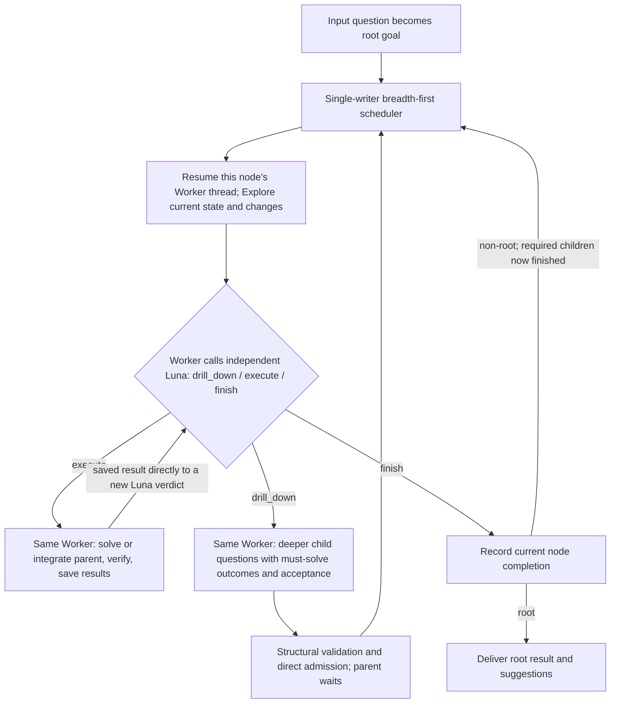

# Task Tree Harness

Single-writer controller for the [task-tree design](../../../docs/task_tree_harness_architecture_v1.md). Python persists the tree and schedules work; this Codex fork runs the workers. New runs use **protocol 3**: the Explore Worker calls an independent `gpt-6-luna` thread through `task_tree_decide`, which returns `drill_down` (下探), `execute` (直接解决), or `finish` (结束). There is no Jev/Alibaba request or decision skill. Saved protocol-3 decisions using the former action word still load as `drill_down`; existing protocol-2 runs retain their original boolean workflow and recorded results.

## Run from this checkout

```sh
./codex/codex-rs/target/debug/codex task-tree doctor --probe-decision
./codex/codex-rs/target/debug/codex task-tree start \
  --workspace /absolute/path/to/project --model gpt-6-sol --effort xhigh \
  'Describe the task and desired deliverable'
```

Isolated root children form independent execution lanes, up to `3` concurrent lanes by default. Use `--parallel-branches N` (`--parallel-siblings` remains an alias) to change the limit; `1` runs serially. Each isolated lane has a copy-on-write workspace on macOS and can advance to its next task as soon as its current turn finishes. Children with `session_mode: inherit` use their parent's Worker thread and run serially with that thread. The controller alone commits Tree and Luna results. Cross-branch dependencies wait for their required results. Branch outputs are published to the root workspace one at a time; a second branch trying to publish the same file is rejected without overwriting the first. Root integration waits for required branches to finish. Existing runs keep their saved evidence; when a paused run first enters branch mode, Worker thread continuity is reset because its prior threads used the shared workspace.

`start` uses the input question verbatim as the root goal and immediately runs its first EXPLORE visit. That visit investigates the task background and saves its evidenced brief for later workers. New runs do not require a separate specification or user approval step; `spec` and `approve` remain available only for older runs awaiting approval.

```sh
./codex/codex-rs/target/debug/codex task-tree status RUN
./codex/codex-rs/target/debug/codex task-tree export RUN
```

Use `resume RUN --reason 'What changed'` after resolving a blocker. The controller home defaults to `$CODEX_HOME/task-tree`; a custom `--home /path/controller` goes before the subcommand. Use the same home for overlapping workspaces so leases prevent concurrent writes. `CODEX_TASK_TREE_PYTHON` selects the Python interpreter loaded by the Rust command.

For task-authorized remote inputs, `start --allow-worker-network` records that permission for worker turns and formal checks. File writes remain workspace scoped. Declare remote inputs so EXPLORE can inspect their actual meaning and limitations.

## Current workflow



Each node uses the same Explore, Luna, execution and completion protocol. An `isolated` child starts its own persistent Worker thread; an `inherit` child resumes its parent's thread. Both modes retain distinct node goals, results and acceptance; Luna always starts a fresh decision thread. Supporting questions that do not merit nodes stay in the current node's `inline_work` and are answered during its execution. If down-probing proposes no new child, the controller executes that node rather than repeating the same decision. After execution, the saved result goes directly to a new Luna verdict; another Explore visit is used when inputs changed or an earlier decision must be reconsidered. A child Explore can use inherited facts and call Luna without new source probes when those facts suffice. Default: `gpt-6-sol / xhigh`. Luna has a fresh read-only thread for each verdict, on a separate app-server transport so the calling Worker's tool callback cannot deadlock its own connection. Native Codex prompts and tools remain available, within the role's sandbox. Luna sees the Worker's factual exploration or execution summary plus controller-bound root goal, original task/ancestor responsibilities, acceptance, actual result references, current child/dependency versions, and other task questions. It decides from this supplied context without opening files or doing research; missing substantive work returns to a Worker.

Every Luna action includes a reason, per-criterion evidence assessments, and one ordered PASS/FAIL/UNKNOWN assessment for each current `must_solve` item; an unresolved item alone does not require down-probing. There is no per-candidate Luna gate and no separately scheduled PREPARE, SPECIFY, SCOPE_REVIEW, REVIEW, COMPLETE, formal-check adoption, or RECONCILE in new protocol-3 runs. Workers perform actual checks while executing and answer the node goal and every `must_solve` item in the saved result. Those answers go to Luna and the parent. When an exact answer is unavailable, the Worker reports attempts, partial findings, why they do not establish the answer, and the missing input or test. Luna can accept an evidenced limit only when the original request permits a bounded answer; a required measurement remains unfinished.

Each new child states `must_solve` as a list of `{problem, verification_method, expected_output}` items, plus `root_contribution`, deliverables, mapped root requirements and parent acceptance. The Worker answers each item and reports its verification status, actual check result and evidence; Luna assesses each item separately without seeing the Worker's status label. A node cannot finish unless both have an evidence-backed PASS for every required item, in addition to its acceptance criteria. Historical string-only nodes remain readable under their original contract. The planner sees the task catalog and identifies semantic overlap. Exact duplicate contracts are reused deterministically; explicit reuse preserves a source-task link and consumed result version. Pending reusable tasks become dependencies; cycles and missing references are rejected atomically. Partial overlap needs only the missing work as a child. Related questions with no material evidence gain are suggestions. No depth or child-count quota forces either completion or further down-probing. A short runtime, one shared file or 'I can do it myself' alone is not a reason to stop descending.

Duplicate comparison includes the full specification, `must_solve` and `root_contribution`; a similar title or goal is insufficient. Explicit reuse must also match that responsibility. The child's planning reason is persisted and delivered to its Worker. Explore gives Luna facts, conditions and relevant open questions, without a Worker routing recommendation. If execution uncovers a deeper related question with a credible path to new evidence, the Worker saves its result and returns that finding for a fresh decision.

Parent obligations do not change when children are created. Completed children only make a parent runnable. Its resumed Worker examines their results; Luna can authorize parent execution, further down-probing, or finish only if an actual current parent delivery already exists. Parent execution independently answers the original responsibility and records the child/dependency result versions it consumed. Merely checking selected sources or completing all children cannot discharge a broader parent question. Only a root `finish` ends the run; simply visiting the root does not.

## Persistence and checks

`TaskRound` phases are the persistent queue; there is no second stack with competing status. READY work is selected breadth first within the available root-child lanes; branches advance independently, while every verdict and state change commits serially. Parents wait until required children/dependencies are current. State saves use revision compare-and-swap; reports, action requests/responses and artifact snapshots are immutable. The submitted request is recorded as the root contract's authorization; no additional confirmation is requested. New files contain `schema_version: 3`; old records remain inspectable and executable under their recorded protocol.

Results retain goal and `must_solve` answers, input hashes, output artifacts, evidence, and consumed child/dependency versions. Explore receives changes and the previous brief instead of being told to repeat all exploration. Unrelated sibling files/catalog growth do not invalidate a verdict. Changed referenced inputs invalidate affected results and their ancestors; completed unaffected branches remain reusable. A finish verdict needs an own delivery with every responsibility answered, current child/dependency versions, all required criterion evidence, and any required real user confirmation. User-facing reports enumerate all discovered findings that materially help answer the question, including detailed numbers, conditions and negative results from child work. These structural guards do not replace Luna's semantic evaluation.

Execution freezes `reports/<round>/delivery.json` with the report, artifact snapshots, input fingerprints and versions actually handed to the Worker. Recovery replays that receipt, never recomputes consumed versions from newer files. A recovered output without a receipt is retained as partial work and goes through fresh exploration. Detected changes to read-only inputs during execution remain stale until reviewed. The controller cannot establish exact remote read timing or make external effects exactly once.

Queue refreshes and scheduling use status and recorded versions, without reading file contents. Startup/resume, parent integration, Worker delivery and finish boundaries validate evidence; each boundary shares a canonical-path hash cache and completion memo. Post-execution auditing checks completed consumers even if the Worker omitted `changed_paths`. Only affected branches reopen. A regression fixture that previously read four files 42 times now reads zero files during queue refresh and each distinct file once during a complete audit.

Exploration is saved **before** calling Luna and remains available after provider failure. The first root exploration establishes shared background; relevant ancestor observations, previous attempts, delivery assessments, remaining work and evidence references enter subsequent context. Worker/Luna prompt payloads have a 64,000-byte UTF-8 budget (not a token count); oversized optional sections become explicit file/JSON-pointer references. Original root/current responsibilities, acceptance, child answers and adverse current evidence are never silently clipped. An oversized protected core raises a clear input error. Read referenced details when relevant, especially the task catalogue before duplicate-sensitive planning.

SSH/URL inputs use `remote_inputs` accessibility/version observations backed by saved probe evidence. They are not passed to local `exists()` or hashed as missing local files. A remote input listed as **required for execution** must be rechecked before finish; an optional cited public page does not force repeat probing. Unavailable required inputs park the task. `unversioned` is an explicit limitation requiring relevant probe evidence and Luna review, not a claim of immutable remote data. Local freshness audits do not poll remote servers.

Invalid plans, repeated empty down-probes or unchanged execution eventually park that node; other runnable branches continue. Missing required external inputs, an exhausted budget or an empty runnable queue never mean success. `resume --reason` retains partial products and restarts exploration after a blocker is resolved. Interrupted execution reserves the workspace until its Worker and any in-flight Luna owner are known to have stopped; external effects are not guaranteed exactly once.

When child inputs have settled into completed/blocked states, the parent gets a bounded `replan_blocked_inputs` visit. A planner may replace a blocked direct child with a different approach using the decomposition report's `replacements`, preserving the full original responsibility and acceptance. Superseded subtrees remain in history; direct consumers follow the replacement. Replacement is rejected atomically if it strands a dependency on a retired descendant, weakens obligations or creates a cycle. Parent execution cannot absorb unfinished children. Replanning is limited by `max_node_no_progress`; an external blocker remains unfinished instead of producing an infinite replacement loop. New source evidence can count as execution progress even without new files, but prose-only changes do not; Luna must assess actual substantive progress and the run-wide budget still applies.

Implementation: `action_protocol.py` defines reports and role prompts; `action_runtime.py` owns protocol-3 scheduling and transitions; `action_context.py` bounds context; `codex_adapter.py` exposes the bound tool and creates independent Luna threads. `actions/*/request.json` preserves full decision context, `sent-request.json` the actual bounded payload, and `response.json` the verdict. Worker contexts similarly have full and `-sent.json` files. `export` includes action reasons and evidence references. Luna inspects targeted acceptance evidence; a command failing because its read-only sandbox prevents a check is an environment limitation, not proof that the product failed.

## Build and test

The Python package uses Python 3.10+, Pydantic 2 and the local Codex Python SDK. The Worker uses existing Codex authentication. No Alibaba key or Ollama process is needed for the current decision path.

```sh
# From harness_analysis with the existing virtualenv:
.venv/bin/uv pip install --python .venv/bin/python --no-deps \
  -e ./codex/sdk/python -e ./codex/experimental/task-tree

# From codex/codex-rs:
cargo build -p codex-cli --bin codex --locked

# From codex:
../.venv/bin/python -m pytest experimental/task-tree/tests -q -o addopts=''
PYTHONPATH=experimental/task-tree/src:sdk/python/src ../.venv/bin/python \
  experimental/task-tree/tests/real_action_smoke.py \
  --directory /absolute/path/to/new/fixture \
  --codex-bin codex-rs/target/debug/codex
```

The small live fixture checks the real tool call, Worker thread reuse, independent Luna verdicts and final file content. `test_action_runtime.py` exercises recursive down-probing, a second descent after parent integration, duplicate reuse, cycles, invalid finish, input changes, blockers and recovery without provider calls. `test_action_regressions.py` covers receipt recovery, obligation-sensitive deduplication, exploration memory, remote probes, bounded replanning/replacement, context limits, novel evidence, undeclared writes and hash-read counts. `real_smoke.py` remains the legacy protocol-2 fixture. The local code-mode host source build may need the upstream V8 artifact; this workstation uses the installed compatible host binary when that artifact is unavailable.

This is a local macOS/Linux prototype. It has no concurrency, distributed execution or benchmark-quality performance claim. Worker plans and model judgments can still be wrong, so explicit acceptance and actual evidence remain required.
